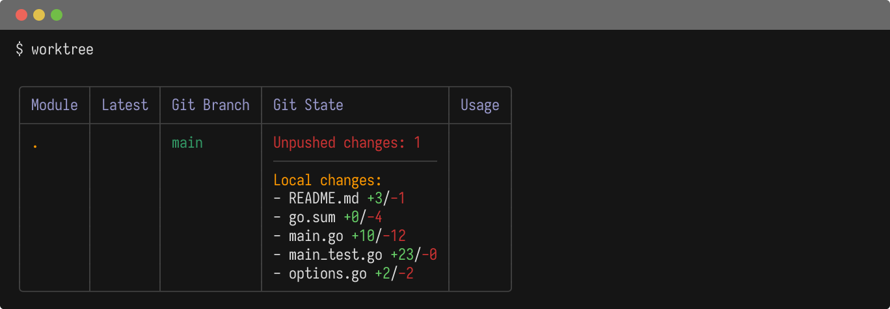
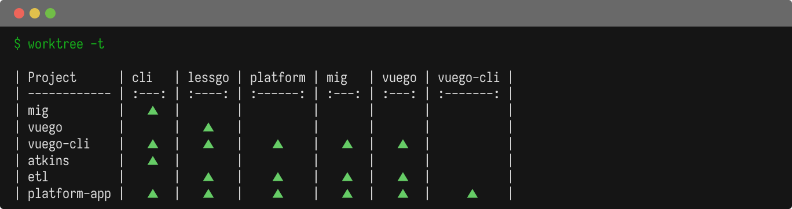
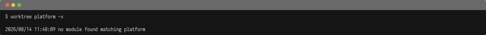
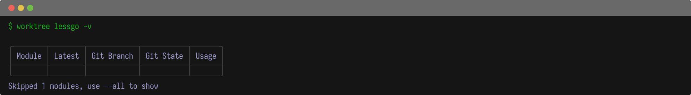
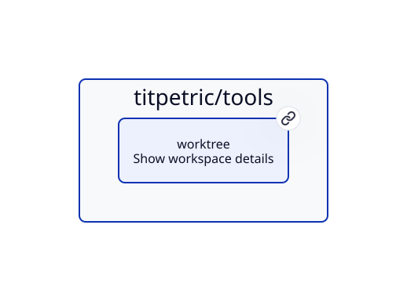
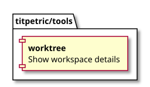

# worktree - Show workspace details



This is a tool for developers that:

- Use `git` workspaces
- Use `go` modules or go workspaces
- Use `gh issues` for issue tracking
- Need insight to their workspaces

The tool reports information and an overview of the workspace state.

To install the tool:

```bash
go install github.com/titpetric/tools/worktree@main
```

Run `worktree` anywhere in your source workspace. It uses the nearest current or parent directory containing `go.work`, `go.mod`, or `.git` as the scan root. If no parent contains one of those markers, it recursively scans the current directory. Go modules and Git repositories are both included; when they share a directory they appear as one row. An optional path argument filters the output to projects matching that path:

```bash
worktree .           # show only the module in the current folder
worktree ./tools     # show all modules under the tools folder
worktree /abs/path   # show modules matching an absolute path
```

By default the scan honours `.gitignore` files. The scan does not descend into an ignored folder, so it skips Git repositories and Go modules inside it; this keeps vendored checkouts and build output out of the listing. The scan reads only `.gitignore` files, not `.git/info/exclude` or the global excludes file, and a pattern applies even to paths that the repository tracks. Set `enable_gitignore: false` in the configuration to turn this off; see [Configuration](#configuration).

Two directory names are never descended into, whatever the configuration says: `testdata`, whose `go.mod` files are test fixtures, and `.git`. A module below either is not listed, and `-u` and `-go` do not rewrite it.

Two commands print the git commands for tagging a new release of the git repository in the current directory. They read the existing tags, detect the latest semver release, ignoring prereleases and tags that aren't semantic versions, and increment it:

```bash
worktree patch   # v1.2.3 -> git tag v1.2.4
worktree minor   # v1.2.3 -> git tag v1.3.0
```

Both commands write to stdout, so you can review the output and then pipe it into a shell:

```bash
worktree patch | sh -x
```

The proposed tag keeps the `v` prefix of the latest tag. If the repository has no release tags yet, the version starts at `v0.0.0`, so `patch` proposes `v0.0.1` and `minor` proposes `v0.1.0`, with a shell comment noting it. A go module nested in a larger repository releases as `<subdir>/vX.Y.Z`; the go tool uses that prefix to tell the releases of one module in a repository from another's, so the proposed tag carries it.

## Resolving a release chain

`worktree resolve` walks the selected modules from their outside dependencies inward and works out what it takes to release each of them:

```bash
worktree resolve            # render the plan
worktree resolve --apply    # perform it
worktree resolve ./tools    # only the modules under a path
```

Without `--apply`, resolve runs nothing and writes nothing. The plan is not a shell script to pipe anywhere, because the run has to read the state of each repository as it reaches it:

| Path    | Module                   | Release                | Resolution                                                                                                                                                                                                                                                         |
|---------|--------------------------|------------------------|--------------------------------------------------------------------------------------------------------------------------------------------------------------------------------------------------------------------------------------------------------------------|
| ./alpha | `example.com/repo/alpha` | `v0.1.0 (+2) → v0.2.0` | `go get -u ./...`<br>`go mod tidy`<br>`git add -- go.mod go.sum`<br>`git commit -m 'alpha: update go.mod, go.sum' -- go.mod go.sum`<br>`api: 2 added, 0 changed, 1 removed`<br>`git tag alpha/v0.2.0`<br>`git push --tags`                                         |
| ./beta  | `example.com/repo/beta`  | `v0.2.0 → v0.2.1`      | `go get -u ./...`<br>`go get example.com/repo/alpha@v0.2.0`<br>`go mod tidy`<br>`git add -- go.mod go.sum`<br>`git commit -m 'beta: update go.mod, go.sum' -- go.mod go.sum`<br>`api: 0 added, 0 changed, 0 removed`<br>`git tag beta/v0.2.1`<br>`git push --tags` |

The `Release` column reads as the version the module is at, the commits it has taken since, and the version it moves to, coloured green for a patch and amber for a minor. No step changes the working directory: every command runs in the module it belongs to, which is the directory the `Path` column names.

Resolve plans the update for every go module carrying a release tag, even one with no commits of its own and nothing in the workspace to move: its dependencies outside the workspace can still have moved, and `go get -u ./...` is the only way to find out. Resolve releases such a module only if the update rewrites `go.mod` or `go.sum`, which the plan says outright and `--apply` finds out for itself. The plan leaves out modules with nothing to do at all, meaning anything untagged and any repository that is not a go module; `--all` lists them, as it does everywhere else in the tool.

Resolve runs `go mod tidy` straight after each `go get`, so the version line the `go get` replaced leaves `go.mod` and its checksums leave `go.sum` before the next `go get` runs.

### Aligning the go version

Resolve brings every selected module up to the highest `go` directive among them, so a workspace resolved together stays on one language version and does not drift a release apart:

```
go mod edit -go=1.27
go get -u ./...
go mod tidy
```

A `toolchain` directive older than the new version would leave `go.mod` invalid, so resolve drops it first with `go mod edit -toolchain=none`; `go get` and `go mod tidy` add a newer one back when they need it.

Moving to another go release series costs a **minor**, whether someone raised the directive by hand since the tag or this run raises it: the module stops building for anyone on the older toolchain, which is as breaking as a symbol going away. A point release of the same series, `1.27` to `1.27.1`, changes nothing for a consumer and stays a patch.

The order is a topological sort of the dependencies among the selected modules, so a module never releases before something it requires. A dependency outside the selection keeps the tag it already carries and never gets a bump. Resolve reports and skips modules left in a dependency cycle.

Resolve pins each module to the version its dependency reaches in this run, meaning the tag this run creates for it and not the tag that exists now: `beta` above requires `alpha@v0.2.0`, a tag the step before it creates. That is the reason for the ordering, and the reason a run that stops does not carry on: every module after the stop would pin a version that never gets created.

`--apply` runs each step and marks it `ok` or `failed`, and a failure stops the run with a non-zero exit status. It performs the release as well, running the same `git tag` and `git push --tags` that `worktree patch` and `worktree minor` print. Resolve judges a repository with no `go.mod` on its git state alone, without the go steps.

### Choosing between a patch and a minor

The release is a minor when it costs a consumer something, and a patch otherwise. The API side of that comes from comparing the exported symbols of the working tree against the latest tag with [`splint diff`](https://github.com/titpetric/tools/tree/main/splint):

- a removed exported symbol, or one whose signature changed, is breaking, and earns a minor,
- so does an exported field a type loses or reshapes, and a method an interface gains, see [Data model changes](#data-model-changes),
- so does moving to another go release series, see [Aligning the go version](#aligning-the-go-version),
- added symbols, a dependency update that only rewrites `go.mod` and `go.sum`, and everything else earn a patch.

Resolve unpacks the tagged revision into a temporary directory and does not check it out, so the working tree stays untouched. Parameter names are not part of a signature, so renaming one is not a change; changing its type is. The comparison leaves out test packages, commands and internal packages, since none of them are API another module can depend on. `-v` lists the symbols behind the count.

Anything that stops the comparison from running - no `splint` installed, a `splint` without the `diff` command, or a revision git cannot read - shows up in place and counts as non breaking, so a missing tool costs a patch release and does not stop the run. `splint` skips files carrying build constraints, so symbols behind a `//go:build` line are invisible to both sides of the comparison.

### Stopping on a dirty repository

Resolve commits `go.mod` and `go.sum` itself. It stages them first, since the update can create a `go.sum` that git does not track yet and a pathspec would not match it, and then commits by pathspec, which leaves every other change in the working tree out of the commit. The commit names only the files that exist. Anything else left in the working tree afterwards stops the run:

| Path       | Module         | Release                | Resolution                                                                                                 |
|------------|----------------|------------------------|------------------------------------------------------------------------------------------------------------|
| ./worktree | tools/worktree | `v0.3.1 (+1) → v0.3.2` | ...<br>api: 4 added, 0 changed, 0 removed<br>M main.go<br>?? resolve.go<br>Stopped: working tree is dirty. |

Releasing a module in that state would tag work nobody reviewed. Under `--apply` the check reads the working tree at the moment it gets there; without it, the plan predicts the state after the commit from the working tree as it stands now, leaving `go.mod` and `go.sum` out of the reckoning. The report marks every module after the stop as not reached, since each would pin a version that never gets created.

## Reporting a release

`worktree verdict` writes the report of a single repository: which version the repository is at or moving to, why, the commits behind it, what became of its exported API, what it changed about depending on it, and how the packages of the working tree divide between what they export and what they keep.

```bash
worktree verdict                            # the repository of the current directory
worktree verdict ./tools/lessgo             # a repository elsewhere
worktree verdict .                          # the root package alone
worktree verdict > NOTES.md                 # markdown, for a release note
worktree verdict --from v0.4.4 --to v0.5.5  # a range of your choosing
worktree verdict --all                      # every release the repository has made
worktree verdict --no-cache                 # read every commit again, cache nothing
```

A path of `.` narrows the verdict to the package at the module root, the way the go tool reads the pattern; the implicit default is `./...`, the whole module. Verdict judges a repository whose root package is its public API on that package: a symbol a subpackage loses is a refactor there, not a breaking release, and the API, data model and commit count tables narrow with it.

It draws a table on a terminal and writes markdown when its output goes anywhere else, so the redirected form pastes into GitHub release notes with the commit hashes already linked.

On a terminal each section is a heading with its table directly beneath it, and a blank line after the table. Verdict writes the heading in bold yellow, a colour no table uses, so nobody reads it as another column heading. A report of two or more releases separates one from the next by two blank lines, so a release stands further from the release below it than its own tables stand from each other.

What it reports depends on where the repository stands:

- **behind its latest tag**, it proposes the next release, comparing the tag against the working tree,
- **level with its latest tag**, it describes the release the tag marks, comparing the tag before it against it. This is the release-note case: tag first, then run the verdict to see what went into it,
- **with no release tag**, it proposes a first release, measured from the start of history.

Verdict compares a release with nothing before it against a module holding no packages at all, so the report lists everything it exports as added and nothing as removed. That is the same report every other release gets, taken from an empty starting point; no release skips the report for want of a tag to compare against.

`--from` and `--to` name the two revisions outright, for a report over a range the repository has moved past. Verdict resolves a bare version to the tag the repository carries for it, including the `<subdir>/` prefix of a nested module, and passes anything else to git as it stands, so a commit or a branch works just as well. Given only `--to`, the range starts at the release below it; given only `--from`, it ends at the working tree. Verdict reports a `--to` naming a release as that release, and anything else as a proposal, since there is no tag to call it by.

Verdict compares the go directive along with the API, so a release that moves to another go release series is a minor and says so, the same rule [resolve](#aligning-the-go-version) applies.

### Every release at once

`worktree verdict --all` reports the whole release chain in one run: it reads every tag and writes one report per release bump, newest first. `--from=all`, `--from=0` and `--from=HEAD` all say the same thing.

Verdict draws the chain between `major.minor` series, not between every tag, so a repository with forty patch releases does not produce forty reports. Given the tags `v0.0.1 v0.0.2 v0.1.0 v0.1.1 v0.2.0 v0.2.1 v0.2.2` and commits on top of the last one, the report holds:

| Range            | What it covers                                                 |
|------------------|----------------------------------------------------------------|
| `since v0.2.2`   | the working tree, and the release it has earned                |
| `v0.2.0..v0.2.2` | the latest release, against the release that opened its series |
| `v0.1.0..v0.2.0` | the move from the 0.1 series to the 0.2 series                 |
| `v0.0.1..v0.1.0` | the move from the 0.0 series to the 0.1 series                 |
| `v0.0.1`         | the first release, measured from the first commit              |

Verdict compares a series against the release that opened the one below it, so it measures `v0.2.0` from `v0.1.0` and not from `v0.1.1`. The opener is the lowest release of the series, which is its `.0` unless nobody tagged that. The patch releases between them get no report of their own; their commits are still there, inside the section spanning them. The latest release earns one anyway when it does not open its own series, since nothing else covers it.

Add `-v` to report every tag instead, each against the one before it: the same history at the granularity of its tags.

`--from` and `--to` bound the chain at either end, naming the releases it runs between. `worktree verdict --all --to v0.5.0` stops at `v0.5.0` and reports nothing after it, including the working tree, which is past its end. `worktree verdict --all --from v0.3.0` starts there and not at the first commit. A range holding no release at all is an error, and verdict writes no empty report for it.

Verdict unpacks and models each revision once for the whole run, so it reads a release ending one section and opening the next once, not twice.

```
# github.com/go-bridget/mig @ v0.6.0

Released v0.6.0: 33 exported symbols were removed and 2 signatures changed since v0.5.5.

## Commits v0.5.5..v0.6.0

| Commit | External | Internal | Subject |
| --- | --- | --- | --- |
| [`29097b5`](https://github.com/go-bridget/mig/commit/29097b5) | +2/~0/-33 | +4/~0/-9 | Restructure mig to drop cmd/ |
| [`ff1fdc2`](https://github.com/go-bridget/mig/commit/ff1fdc2) | +0/~2/-0 |  | migrate: rework api |

## API v0.5.5..v0.6.0

| Change | Package | Symbol | Commits |
| --- | --- | --- | --- |
| Added | /migrate | type Manager | [`29097b5`](https://github.com/go-bridget/mig/commit/29097b5) |
|  |  | func NewManager (db *sqlx.DB, migrations fs.FS, project string) (*Manager, error) | [`29097b5`](https://github.com/go-bridget/mig/commit/29097b5) |
|  |  | --- |  |
|  |  | type loader | [`29097b5`](https://github.com/go-bridget/mig/commit/29097b5) |
| Removed | /cmd/mig/gen | type Column | [`29097b5`](https://github.com/go-bridget/mig/commit/29097b5) |
|  | /migrate | func Load (fsys fs.FS, project string) error | [`29097b5`](https://github.com/go-bridget/mig/commit/29097b5) |
```

The category names the first row of its group and the rows below it leave the column empty; the table draws no rule between rows, so a group reads as one block. The `Package` column is there whatever the module holds, since `const Name` on its own says nothing about where it lives. The symbols of a package sit together within their category and only the first of them names it, the same way the data model table reads. Wherever the report lists counts and categories, the order is what the release added, what it reshaped, what it took away.

The `Package` column is the import path below the module, written from the module root down: `/model` is the model package of this module and `/frontend/model` is the other one, where a bare `model` twice over says nothing about which is which. The package at the root of the module is `/`.

Exported and unexported symbols share the `Symbol` column. Within a package the API comes first and what a consumer cannot reach comes under a divider, so the reader after what the release costs stops at the rule and the reader after what the refactor moved carries on past it. Verdict draws the rule across the symbol column alone, as `---` in markdown and as a line on a terminal. A package whose symbols are all internal draws no rule: there is nothing above it to part it from, and the whole of its block is internal.

The `External` and `Internal` columns of the commit table count what one commit did on its own, in the order the rest of the report reads: what it added, what it reshaped, what it took away. External is what a consumer can see and Internal what it cannot; the two columns tell a release from a refactor. Verdict compares each commit against the one under it, so a range of twenty commits is twenty comparisons and a reader can pick the commit behind a removal out of them. A commit that moved neither half leaves the cells empty where three zeroes would stand, and a commit that touched no file of the module does not appear at all.

The `Commits` column of the API table names the commits behind each symbol, oldest first, linked the way the commit table links them. A symbol added by one commit and reshaped by another lists both. The data model table carries the same column, for the commits behind each field.

### Reading history once

Reading a range commit by commit means modelling every commit in it, and on a repository with a few hundred of them that takes minutes, not seconds. A commit cannot change, and neither can the model of one, so verdict keeps the models on disk and every later run reads them back:

```
~/.cache/worktree/verdict-<key>.json
```

The directory is the one `os.UserCacheDir` names, which is `$XDG_CACHE_HOME/worktree` or `~/.cache/worktree` on Linux and `~/Library/Caches/worktree` on macOS. The key is the module, the commit the revision resolves to, the splint binary that read it, and the layout of the entry. A run resolves a tag to its commit before the lookup, so moving a tag to another commit reads a different entry from the one the tag pointed at before. Installing another splint does the same. The cache never keeps the working tree, the one revision that can change under a run.

`--no-cache` reads every commit again and writes nothing; reach for it when splint itself changed. A cache directory the run cannot create, or an entry it cannot write, makes a slower run and not a failed one.

### Data model changes

The exported fields of a type are a promise to a consumer as much as a func signature is, so the report covers them too, under a **Data model** section. The section holds one table for every type the release touched, laid out like the API table above it: `Change | Package | Type | Field | Commits`, grouped by what the release did, with the cells that repeat the row above them left empty.

```
## Data model v0.0.1..v0.1.0

| Change | Package | Type | Field | Commits |
| --- | --- | --- | --- | --- |
| Added | /commands/docs | DocMeta ▲ | Layout string `yaml:"layout"` | [`4b1c0aa`](https://example.com/commit/4b1c0aa) |
|  |  |  | Title string `yaml:"title"` | [`4b1c0aa`](https://example.com/commit/4b1c0aa) |
|  |  | Tab ▲ | IsCode bool | [`9d70e31`](https://example.com/commit/9d70e31) |
|  | /tour | Lesson | FileOptions map[string][]string | [`0f21c8e`](https://example.com/commit/0f21c8e) |
|  |  | Module | FS fs.FS | [`0f21c8e`](https://example.com/commit/0f21c8e) |
| Changed | /config | Config | Addr string `yaml:"addr"` -> []string `yaml:"addr"` | [`c4a55d2`](https://example.com/commit/c4a55d2) |
| Removed | /tour | Chapter | Slug string | [`0f21c8e`](https://example.com/commit/0f21c8e) |
```

The `▲` marks a type the release introduces, the same mark the [dependency matrix](#information-summarized) uses for something present now. Its rows are the shape it declares, so a reader sees what the type is and not only that it exists; the table leaves out unexported fields, since nothing outside the module can reach them. A type without the mark existed before the range, and the table writes it as the fields that moved on it, without the whole declaration again.

The category opens a group and the package and type repeat under it, no matter how far the group above them reached. Within a group the rows read by package, then type, then field.

The `Field` column carries the name and the shape, since the name has no column of its own. A field that moved appears once under its name with the shape on either side of the move, the way the API table writes a changed signature. An interface needs no treatment of its own: its methods sit in the same column, so the type and the field together read as `store.Store.Put`.

What a data model change costs depends on the shape:

| Shape     | field added  | field reshaped | field removed |
|-----------|--------------|----------------|---------------|
| struct    | not breaking | breaking       | breaking      |
| interface | breaking     | breaking       | breaking      |

Adding a method to an interface stops every implementor compiling, where adding a field to a struct costs a consumer nothing. Verdict compares a struct tag along with the field type and counts a tag change as a reshape: a document decodes through the tag, so renaming a `json` or `yaml` key breaks every document already written even though the code reading it still compiles. An embedded field goes by the last identifier of the type it embeds, and counts because it promotes the method set of that type.

A breaking data model change earns a minor the same way a removed symbol does, and the verdict says which: `Minor release: v0.2.0, because 1 exported field moved since v0.1.0.`

This needs a [splint](https://github.com/titpetric/tools/tree/main/splint) that reports the field comparison. An older one reports only the symbols, and the report leaves the section out.

### Dependency changes

A package is only half of what a consumer takes on. The other half is the dependency set it drags in, which decides what the consumer downloads, which version floors its own build has to meet, and whose code lands in the binary. So verdict compares the `go.mod` of the two revisions too, under a **Dependencies** section:

```
## Dependencies v0.5.5..v0.6.0

| Change | Module | Version |
| --- | --- | --- |
| Added | github.com/google/go-cmp | v0.7.0 |
|  | golang.org/x/sync | v0.23.0 |
| Changed | golang.org/x/mod | v0.40.0 -> v0.41.0 |
| Removed | gopkg.in/yaml.v3 | v3.0.1 |
```

The section follows the layout of the tables above it: grouped by what the release did, the category naming the first row of its group, and the cells that repeat the row above them left empty. A dependency that moved appears with the version on either side of the move, the way a changed signature does. The module path appears in full, since the path identifies the dependency and does not locate it. A release that touched no `go.mod` gets no section.

The section lists only the dependencies the module imports itself. `go mod tidy` writes the indirect ones without anyone deciding on them, and a routine tidy rewrites dozens of them, which buries the handful of direct ones that make the release note. A dependency direct on either side of the comparison counts as direct, so the section reports one the module took on an import of, whichever way it moved.

**Nothing here earns a release a minor.** A dependency is not API: moving one takes nothing away that a compiler will complain about, so the section explains the release and does not decide it. The report names it after the reason, in the sentence that follows the verdict:

```
Patch release: v0.5.6, no exported symbols were removed since v0.5.5. 1 dependency was added and 2 dependencies moved to another version.
```

The `go` directive is the one entry of a `go.mod` that can stop a build outright, and verdict [reports and judges it on its own](#aligning-the-go-version) and leaves it out of this table.

Verdict reads the comparison from the same two models as the API tables, so it costs no extra work and needs nothing of the repository that the API did not already need. Verdict compares a release measured from the start of history against a module requiring nothing, so a first release lists everything it requires as added, the same way it lists everything it exports.

### Visibility

The report ends on what each package of the working tree declares, split into the half a consumer can reach and the half it cannot. It answers a different question from the tables above it: not what the release moved, but where the module keeps its weight as it stands.

```
## Visibility, the working tree

| Package | Types | Funcs | Ratio |
| --- | --- | --- | --- |
| ./ | 14 / 0 | 30 / 6 | 15.1% |
| ./frontend | 0 / 4 | 14 / 20 | 80.6% |
| ./model | 23 / 2 | 70 / 32 | 21.4% |
```

`Types` and `Funcs` read exported over internal, counted by the case of the declared name: a method counts as a func, and `(*Tracer).serveHTTP` is internal the way a free function is. `Ratio` is the code inside internal func bodies over the func code of the package, blank lines and comments left out of both. Test files stay out, and so does the `internal` tree: Go scopes it to the module already, whatever it exports.

The report states the counts and does not judge them. There is no share of internal code a package ought to carry: a parser keeps most of its code private and a data model exports most of its own, and both are right that way. What the table is for is reading one package against another, and against what the same package looked like a release ago.

This needs [splint](https://github.com/titpetric/tools/tree/main/splint) on the path. Without it the report leaves the section out, the way an unreadable API leaves out the tables above.

### Counts alone

`--stats` collapses the analysis to one table, a row per release, which is the shape to read a long chain in:

```bash
worktree verdict --all --stats
```

```
# github.com/titpetric/vuego-cli

| Version | Since | Commits | Symbols + | Symbols ~ | Symbols - | Fields + | Fields ~ | Fields - |
| --- | --- | --- | --- | --- | --- | --- | --- | --- |
| v0.3.0 | v0.2.0 | 11 | 1 | 0 | 0 | 0 | 0 | 0 |
| v0.2.0 | v0.1.0 | 5 | 34 | 0 | 0 | 0 | 0 | 0 |
| v0.1.0 | v0.0.1 | 87 | 26 | 2 | 2 | 2 | 0 | 1 |
| v0.0.1 |  | 9 | 43 | 0 | 0 | 0 | 0 | 0 |
```

The table names the module once, without a version, since its rows hold them. It works on a single verdict too, where the table has one row. On a terminal a zero shows in grey, so the releases that did something stand out from the ones that did not.

These flags invoke tool functionality:

- `-v`, or `--verbose`, prints a detailed verbose view with extra data, and names every untracked file where the default names the folder standing in for it, as `--all` also does; with `-u`, the update status also lists each `go get` and `go mod tidy` command that ran and marks successful commands with a green check,
- `-u` updates the stale dependencies of each selected Go module, meaning the workspace modules it requires at a version below their latest tag, with `go get <module>@<tag>`, and then runs `go mod tidy`. Dependencies outside the workspace and workspace modules already at their latest tag stay as they are; the output reports a module with nothing stale as `Already up to date.` without running the go tool. It displays each module's path, module name, and the resulting `go.mod` changes (`dep v1.0.0 → v1.1.0`, `+ dep`, `- dep`, or `Already up to date.`). Results print one line at a time as each module finishes, so progress is visible while the remaining modules are still updating; the path and module name of the module in progress appear before its results. Version changes to an existing dependency are orange, new dependencies green, dropped ones grey, and failing commands show in red. Use `worktree -u ./...` to update every Go module under the workspace root,
- `-U` updates every dependency of each selected Go module with `go get -u ./...`, including ones outside the workspace, before applying the workspace tag updates and `go mod tidy` that `-u` performs. It implies `-u`,
- `--go=<version>` sets the `go` directive of every `go.mod` and `go.work` in the workspace to that version and then performs the same update as `-u`. The version takes the form `1.27`, `1.27.1` or `go1.27`. The update drops a `toolchain` directive older than the new version, since it would leave the file invalid; `go get` and `go mod tidy` add a newer one back when they need it. The output lists changed `go.work` files before the update table, and each module's go directive change (`go 1.25 → 1.27`) appears in its update status. A module whose `go.mod` already declares the version shows as `Already up to date.` and the go tool does not run for it, so a repeated run over an updated workspace returns immediately. Combine it with `-u` to update the stale dependencies of every module regardless of its go directive,
- `--exec=<command>` runs a shell command in every Go module, through `bash -c` so pipes and compound commands work, e.g. `worktree --exec 'go get ./... && go mod tidy'`. The same table as `-u` streams a row per module; the command's output is always shown, a silent success reads `Done.`, and a failure adds the exit status in red. The exit code is non-zero when the command failed in any module,
- `--pull` pulls new changes for every Git repository in the workspace and displays each repository's path, first remote, branch, and `git pull` output as a table,
- `-t` outputs a dependency matrix, with a green `▲` for current and yellow `▲*` for outdated dependencies. Project names show dark-grey `(+N)` for commits ahead and a dark-orange `*` for local Git changes; the matrix drops empty rows and columns, except that projects with local changes always show. A footer summarizes these workspace states,
- `-puml` will render a plantuml representation of the workspace,
- `-d2` will render a d2 representation of the workspace,
- `--apply` makes `worktree resolve` perform the plan it would otherwise only render, and `worktree changelog` write the release notes it would otherwise only list; see [Resolving a release chain](#resolving-a-release-chain) and [Backfilling release notes](#backfilling-release-notes).

Table output uses the rounded, colored terminal format when stdout is an ANSI terminal and falls back to Markdown when redirected or piped.

The `Git State` column lists the untracked paths of a module. A folder holding nothing tracked stands in for everything below it, named in orange with what it holds, `demos/common/ +17 dirs, +91 files, +7921 SLOC`, so a new subtree costs one line whatever number of files it holds. A new file in a folder that is otherwise tracked still gets named, with the lines it adds. `-v` and `--all` name every file instead.

The `Go` column holds each module's go directive. The tool compares the versions as semantic versions, where a missing patch reads as `.0` and a release candidate such as `1.27rc1` sorts below `1.27`. Every module below the highest version the workspace declares shows in orange, the rest in teal. Module import paths lose their `github.com/` prefix, so the module column stays narrow.

## Backfilling release notes

`worktree changelog` takes the verdict of every tag and makes it the GitHub release note of that tag. It reads the releases the repository already has and reports what each tag takes, one row per tag, newest first:

```bash
worktree changelog            # what every tag takes
worktree changelog --apply    # write the notes of the releases that hold none
worktree changelog ./lessgo   # a repository elsewhere
```

```
| Tag | Status | Note |
| --- | --- | --- |
| v0.3.0 | current | The release holds the note already. |
| v0.2.1 | differs | The release holds a note of its own, which is left as published. |
| v0.2.0 | fill | The release holds no note.<br>gh release edit v0.2.0 --notes-file - |
| v0.1.0 | create | No release names the tag.<br>gh release create v0.1.0 --verify-tag --title v0.1.0 --latest=false --notes-file - |
```

**This is a backfill.** `--apply` writes only to the releases holding no note: a tag with no release at all, and a release published empty. A body somebody already wrote is what a reader of that release has been reading, and a note generated from the history is no reason to take it away, so the report lists the two states holding one and leaves them alone.

The `Status` column is what the tag takes:

| Status     | What the remote holds                                                   | What `--apply` does |
|------------|-------------------------------------------------------------------------|---------------------|
| `create`   | no release names the tag                                                | creates it          |
| `fill`     | a release that is there with nothing written in it                      | writes the note     |
| `current`  | a release whose body is the note already                                | nothing             |
| `differs`  | a release holding a body of its own, which is not the note              | nothing             |
| `unpushed` | a tag that exists here and not on the remote, which no release can name | nothing             |

Changelog reports `differs` and does not act on it. A published note whose body has stopped matching the history needs a maintainer to look at it, and the next step is a decision nobody wants made for them; `gh release edit <tag> --notes-file -` is the one-liner when the maintainer decides to replace it.

Without `--apply` changelog writes nothing and the `Note` column holds the `gh` command it would run. With it, the command runs and the row carries the green check a resolved module carries; `-v` adds what `gh` printed, which for a created release is its URL.

A tag that fails to publish does not stop the run. The releases are independent, and a rejected tag leaves the tag after it no less publishable, so changelog tries every tag and the failures become the exit status.

Each note is one release measured from the release below it, which is `worktree verdict --to <tag>` for every tag in turn. Changelog unpacks and models every revision once for the whole run, the way [a release chain reads history](#reading-history-once), so a repository of forty tags is forty comparisons and not eighty. The note leaves out the [visibility table](#visibility): that table counts the working tree and not the release, so it would repeat in every note and match the release in the newest note alone.

`--from` and `--to` bound the tags reported on, naming the releases the run works between, the way they bound a release chain.

How changelog writes a note:

- changelog creates a release with `--verify-tag`, so `gh` rejects a tag the remote does not carry and does not create one at the head of the default branch, which for a note about an old release would be a tag pointing at the wrong commit,
- changelog creates a release stating outright whether it counts as the latest one, so publishing a note for a release from a year ago does not take the `Latest` badge from the release that holds it,
- a release published empty gets its body written and nothing else: its title, its assets and its place among the releases stay as they are,
- the note goes to `gh` on standard input, since it runs to thousands of characters and an argument list is no place for one,
- changelog cuts a note over the 125000 characters GitHub stores at a line boundary, with a line saying where.

Changelog compares the bodies one line at a time to decide between `current` and `differs`, not byte for byte. GitHub stores a body with CRLF line endings and trims what follows its last line, so a note read back never equals the string changelog sent, and without that comparison every note would read as `differs` from the moment of publishing.

This needs [gh](https://cli.github.com) on the path, authenticated against the remote. Reading the releases and the tags is one paginated call each; writing is one call per tag that takes one.

## Configuration

Command line flags select what to display and what to update. The configuration file `~/.config/worktree.yml` sets how the tool scans the workspace. Run `worktree config` to edit it in a form, printed inline in the same frame the tables use:

```bash
worktree config
```


The form shows every setting at once, each on its own row with its value and a short description of what it does; the bottom border captions the file it writes. No dialog hides any of it.

Arrow keys move between rows. `←`, `→` or `Space` toggles a flag where it stands. You type a list setting where it stands, its entries separated by commas. `Enter` on a setting changes nothing and moves the focus to the `Save` button below the settings, where `Enter` writes the file; `Discard` beside it leaves the file alone. Saving a form with nothing changed writes nothing. `F10` saves from any row, `Esc` leaves, or moves to `Discard` first when edits remain unsaved.

The settings are:

| Key                     | Default                     | Meaning                                                                                                                                                             |
|-------------------------|-----------------------------|---------------------------------------------------------------------------------------------------------------------------------------------------------------------|
| `scan.enable_gitignore` | `true`                      | Honour `.gitignore` files while walking.                                                                                                                            |
| `scan.enable_git_repos` | `true`                      | List Git repositories that are not also Go modules.                                                                                                                 |
| `scan.ignore_paths`     | empty                       | Directory names never descended into, whatever a `.gitignore` says about them. Matched against the directory name alone, at any depth.                              |
| `scan.root_markers`     | `go.work`, `go.mod`, `.git` | Files marking the workspace root. The nearest parent directory holding one of them becomes the scan root; with no markers the scan starts in the current directory. |

Turn `enable_gitignore` off when a repository consolidates further Git checkouts below it and gitignores those folders to keep them out of its own index. With the setting on, those checkouts are never descended into, so they do not appear at all:

```yaml
scan:
  enable_gitignore: false
```

`ignore_paths` is the way to keep such a listing clean. The list starts empty because it also overrides a negation that re-includes the name, such as `!vendor`:

```yaml
scan:
  enable_gitignore: false
  ignore_paths:
    - node_modules
    - vendor
```

The file is the complete configuration. The built-in defaults do not apply underneath it, so a setting the file does not name reads as off, and the file names every setting so that off is what a missing key means. `worktree config` always writes every key back, so editing through the setup screen cannot drop one. Where a flag and a setting ever cover the same behaviour, the flag given on the command line wins.

When no file exists the built-in defaults apply, which match the behaviour of the tool before it became configurable. The tool reports a file it cannot parse and does not ignore it; `worktree config` still opens on it, starting from the defaults, so you can fix it.

You can create a symlink to `git-st`.

```bash
cd /usr/local/bin
ln -s /usr/local/bin/worktree git-st
```

Creating the symlink enables running `git st` and `git st -v`.

## Information summarized

The tool scans and displays information about:

- Go module name
- Go version from the go.mod go directive
- Go module versions in use (for updates)
- Go module dependencies in workspace
- README.md title as the description
- Latest git version tag
- Git commits since version tag
- Git branch in source tree
- Unpushed git commits
- Local changes to source tree
- Untracked changes to source tree, collapsed to a folder
- GitHub issues (gh issue list)

It's focused on summarizing of Go workspaces, or git checkouts of standalone Go modules. Git support may later grow to account for custom remotes and checkouts that aren't a go module source tree.

## Examples

### Summary workspace view

The following screenshots show standard output, workspace filtering and verbose output for the complete workspace.








### D2 Diagram



### PlantUML Diagram



## Why?

Using a go workspace is a smooth enough experience, but most software still gets built and delivered outside a workspace.

This process requires updating the go.mod dependencies as a new version gets tagged. For each module in a workspace, the goals are:

- using the latest release across the workspace in go.mod
- seeing any local changes not yet commited or pushed
- updating dependencies in the correct order

## Alternatives considered

For years now, the author has used `git st` to get a recursive view of a git source tree, keeping a bash version of it in a dotfiles repository, and a php version eons ago. Let's consider this something like a v3 for the approach.

Git source trees don't carry enough dependency information, so this tool reads in go.mod go.work files and reports the relevant information to you.
